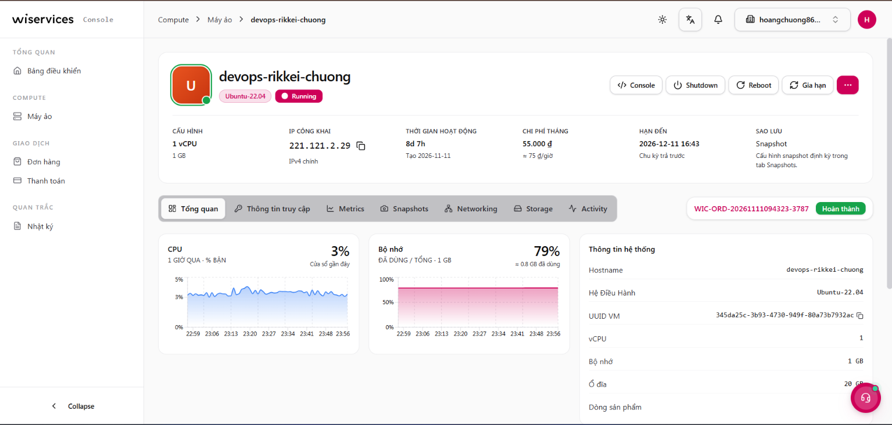
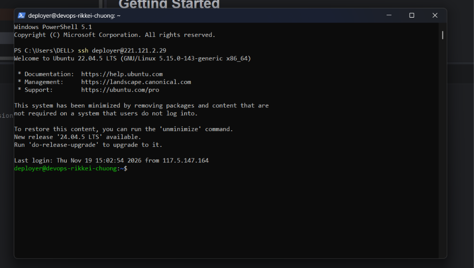
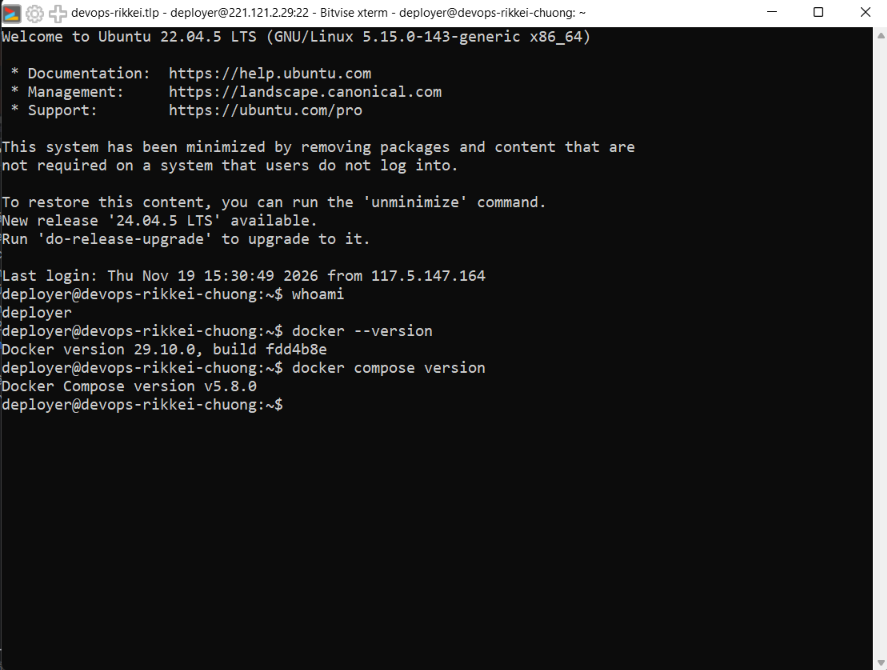
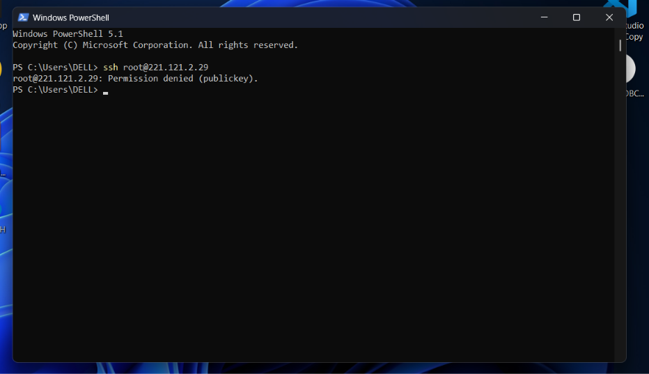
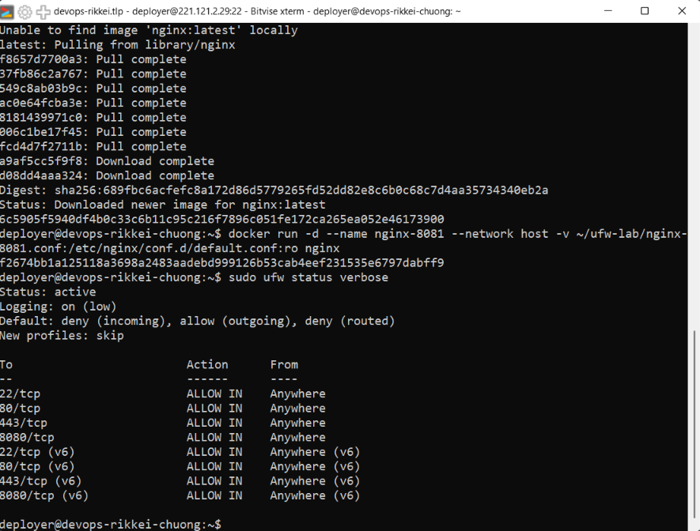

# MD05 - Session 10 - Homework

## Bài tập 1: Khởi tạo và kết nối VPS

### 1. Thông tin VPS (môi trường Staging)

| Thông số        | Giá trị                          |
|-----------------|----------------------------------|
| Nhà cung cấp    | WiServices Cloud                 |
| Hostname        | `devops-rikkei-chuong`           |
| Hệ điều hành    | Ubuntu 22.04.5 LTS               |
| Kernel          | 5.15.0-143-generic (x86_64)      |
| CPU / RAM / Ổ đĩa | 1 vCPU / 1 GB / 20 GB          |
| IP public       | `221.121.2.29`                   |
| Trạng thái      | Running                          |
| User đăng nhập  | `deployer` (user thường, không dùng `root`) |
| Phương thức xác thực | SSH key (không dùng password) |

### 2. Cấu hình thông số VPS trên giao diện Cloud



### 3. Kết nối SSH vào VPS

Từ PowerShell trên máy cá nhân (Windows), kết nối bằng SSH key:

```powershell
ssh deployer@221.121.2.29
```

Kết quả đăng nhập thành công (prompt `deployer@devops-rikkei-chuong:~$`):



### 4. Ghi chú về bảo mật

- Đăng nhập bằng **SSH key** thay vì password: private key nằm trên máy cá nhân, chỉ public key được đặt vào `~/.ssh/authorized_keys` của user `deployer` trên VPS, tránh bị brute-force mật khẩu.
- Sử dụng user riêng `deployer` thay vì `root` để triển khai ứng dụng, giới hạn quyền khi có sự cố.
- Có thể tăng cường thêm trong `/etc/ssh/sshd_config`:
  ```
  PasswordAuthentication no
  PermitRootLogin no
  ```

---

## Bài tập 2: Tạo User Deploy và Cài đặt Docker

> User deploy được đặt tên là **`deployer`** (đã tạo từ Bài tập 1), đóng vai trò user `deploy` theo yêu cầu đề bài.

### 1. Danh sách lệnh đã thực thi

Xem file [`docs/bt2-commands.txt`](docs/bt2-commands.txt), gồm các bước:

1. Truy cập VPS bằng `root`.
2. Tạo user `deployer`, cấp quyền `sudo`, cấu hình SSH key.
3. Cài Docker Engine + Docker Compose plugin từ repository chính thức của Docker.
4. Thêm `deployer` vào group `docker` (chạy docker không cần `sudo`).

### 2. Kết quả

| Kiểm tra          | Kết quả                                                     |
|-------------------|-------------------------------------------------------------|
| `id`              | `groups=1000(deployer),27(sudo),113(docker)`                |
| `docker --version`| `Docker version 29.10.0, build fdd4b8e`                     |
| `docker compose version` | `Docker Compose version v5.8.0`                      |

Ảnh chụp Terminal chạy `docker --version` dưới quyền user `deployer`:



---

## Bài tập 3: Tăng cường bảo mật SSH

### 1. Các lệnh tạo và cấu hình SSH Key

Xem file [`docs/bt3-commands.txt`](docs/bt3-commands.txt), gồm các bước:

1. Tạo cặp khóa `ed25519` trên máy cá nhân bằng `ssh-keygen`.
2. Copy public key (`cat ~/.ssh/id_ed25519.pub`) vào `/home/deployer/.ssh/authorized_keys` trên VPS.
3. Cấu hình `/etc/ssh/sshd_config`:
   ```
   PermitRootLogin no
   PubkeyAuthentication yes
   PasswordAuthentication no
   KbdInteractiveAuthentication no
   ```
   Đồng thời sửa `/etc/ssh/sshd_config.d/50-cloud-init.conf` (được đọc trước và có thể ghi đè `PasswordAuthentication yes`).
4. Kiểm tra bằng `sshd -t` / `sshd -T`, rồi `systemctl restart ssh`.

### 2. Kết quả

- `deployer` đăng nhập bằng SSH key: **thành công**.
- `root` đăng nhập: **bị từ chối** (`Permission denied (publickey)`).



---

## Bài tập 4: Cấu hình Firewall UFW

### 1. Các lệnh đã thực thi

Xem file [`docs/bt4-commands.txt`](docs/bt4-commands.txt), gồm:

1. Mở `22/tcp` trước, đặt `default deny incoming` / `default allow outgoing`.
2. Mở `8080/tcp` (và `80/tcp`, `443/tcp` để chuẩn bị cho web server), rồi `ufw enable`.
3. Chạy 2 container Nginx ở cổng `8080` và `8081`.
4. Truy cập từ bên ngoài để so sánh.

> **Lưu ý: Docker bỏ qua UFW.** Khi publish port bằng `docker run -p 8081:80`, Docker tự thêm rule iptables và NAT traffic vào container trước khi gói tin tới các rule của UFW, nên cổng 8081 vẫn truy cập được dù UFW không mở. Vì vậy bài này chạy Nginx với `--network host`, để traffic đi qua chain `INPUT` và bị UFW lọc đúng như mong đợi.

> **Lưu ý: tường lửa Cloud.** Ngoài UFW trên VPS, WiServices còn một lớp tường lửa ở tầng Cloud (tab Networking). Gói tin phải qua cả 2 lớp, nên cần thêm rule `IN / ACCEPT / TCP / Đích cổng 8080` trên giao diện Cloud thì cổng 8080 mới truy cập được từ bên ngoài. Cổng 8081 không được mở ở lớp nào.

### 2. Trạng thái UFW



### 3. Truy cập cổng 8080 thành công


### 4. Truy cập cổng 8081 thất bại


