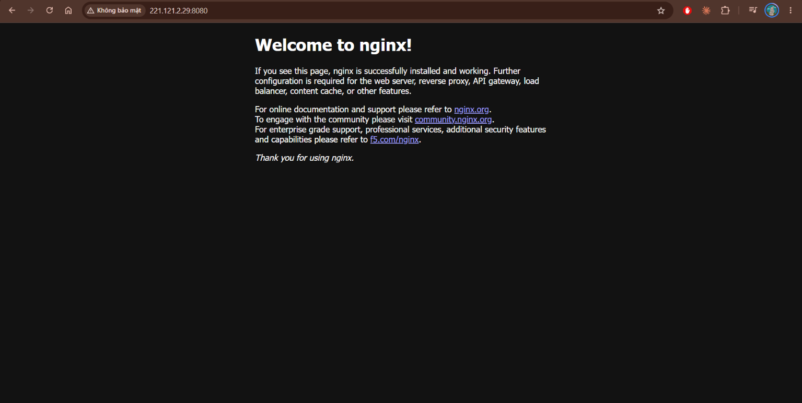
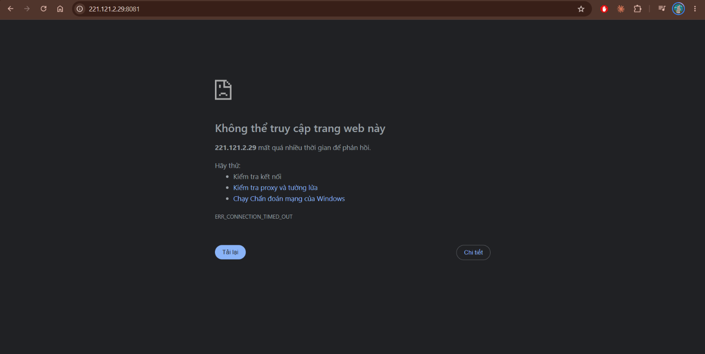

# MD05 - Session 10 - Homework

## Bài tập 1: Khởi tạo và kết nối VPS

### 1. Thông tin VPS (môi trường Staging)

| Thông số        | Giá trị                          |
|-----------------|----------------------------------|
| Nhà cung cấp    | WiServices Cloud                 |
| Hostname        | `devops-rikkei-chuong`           |
| Hệ điều hành    | Ubuntu 22.04.5 LTS               |
| Kernel          | 5.15.0-143-generic (x86_64)      |
| CPU / RAM / Ổ đĩa | 1 vCPU / 1 GB / 20 GB          |
| IP public       | `221.121.2.29`                   |
| Trạng thái      | Running                          |
| User đăng nhập  | `deployer` (user thường, không dùng `root`) |
| Phương thức xác thực | SSH key (không dùng password) |

### 2. Cấu hình thông số VPS trên giao diện Cloud


### 3. Kết nối SSH vào VPS

Từ PowerShell trên máy cá nhân (Windows), kết nối bằng SSH key:

```powershell
ssh deployer@221.121.2.29
```

Kết quả đăng nhập thành công (prompt `deployer@devops-rikkei-chuong:~$`):


### 4. Ghi chú về bảo mật

- Đăng nhập bằng **SSH key** thay vì password: private key nằm trên máy cá nhân, chỉ public key được đặt vào `~/.ssh/authorized_keys` của user `deployer` trên VPS, tránh bị brute-force mật khẩu.
- Sử dụng user riêng `deployer` thay vì `root` để triển khai ứng dụng, giới hạn quyền khi có sự cố.
- Có thể tăng cường thêm trong `/etc/ssh/sshd_config`:
  ```
  PasswordAuthentication no
  PermitRootLogin no
  ```

---

## Bài tập 2: Tạo User Deploy và Cài đặt Docker

> User deploy được đặt tên là **`deployer`** (đã tạo từ Bài tập 1), đóng vai trò user `deploy` theo yêu cầu đề bài.

### 1. Danh sách lệnh đã thực thi

Xem file [`docs/bt2-commands.txt`](docs/bt2-commands.txt), gồm các bước:

1. Truy cập VPS bằng `root`.
2. Tạo user `deployer`, cấp quyền `sudo`, cấu hình SSH key.
3. Cài Docker Engine + Docker Compose plugin từ repository chính thức của Docker.
4. Thêm `deployer` vào group `docker` (chạy docker không cần `sudo`).

### 2. Kết quả

| Kiểm tra          | Kết quả                                                     |
|-------------------|-------------------------------------------------------------|
| `id`              | `groups=1000(deployer),27(sudo),113(docker)`                |
| `docker --version`| `Docker version 29.10.0, build fdd4b8e`                     |
| `docker compose version` | `Docker Compose version v5.8.0`                      |

Ảnh chụp Terminal chạy `docker --version` dưới quyền user `deployer`:


---

## Bài tập 3: Tăng cường bảo mật SSH

### 1. Các lệnh tạo và cấu hình SSH Key

Xem file [`docs/bt3-commands.txt`](docs/bt3-commands.txt), gồm các bước:

1. Tạo cặp khóa `ed25519` trên máy cá nhân bằng `ssh-keygen`.
2. Copy public key (`cat ~/.ssh/id_ed25519.pub`) vào `/home/deployer/.ssh/authorized_keys` trên VPS.
3. Cấu hình `/etc/ssh/sshd_config`:
   ```
   PermitRootLogin no
   PubkeyAuthentication yes
   PasswordAuthentication no
   KbdInteractiveAuthentication no
   ```
   Đồng thời sửa `/etc/ssh/sshd_config.d/50-cloud-init.conf` (được đọc trước và có thể ghi đè `PasswordAuthentication yes`).
4. Kiểm tra bằng `sshd -t` / `sshd -T`, rồi `systemctl restart ssh`.

### 2. Kết quả

- `deployer` đăng nhập bằng SSH key: **thành công**.
- `root` đăng nhập: **bị từ chối** (`Permission denied (publickey)`).


---

## Bài tập 4: Cấu hình Firewall UFW

### 1. Các lệnh đã thực thi

Xem file [`docs/bt4-commands.txt`](docs/bt4-commands.txt), gồm:

1. Mở `22/tcp` trước, đặt `default deny incoming` / `default allow outgoing`.
2. Mở `8080/tcp` (và `80/tcp`, `443/tcp` để chuẩn bị cho web server), rồi `ufw enable`.
3. Chạy 2 container Nginx ở cổng `8080` và `8081`.
4. Truy cập từ bên ngoài để so sánh.

> **Lưu ý: Docker bỏ qua UFW.** Khi publish port bằng `docker run -p 8081:80`, Docker tự thêm rule iptables và NAT traffic vào container trước khi gói tin tới các rule của UFW, nên cổng 8081 vẫn truy cập được dù UFW không mở. Vì vậy bài này chạy Nginx với `--network host`, để traffic đi qua chain `INPUT` và bị UFW lọc đúng như mong đợi.

> **Lưu ý: tường lửa Cloud.** Ngoài UFW trên VPS, WiServices còn một lớp tường lửa ở tầng Cloud (tab Networking). Gói tin phải qua cả 2 lớp, nên cần thêm rule `IN / ACCEPT / TCP / Đích cổng 8080` trên giao diện Cloud thì cổng 8080 mới truy cập được từ bên ngoài. Cổng 8081 không được mở ở lớp nào.

### 2. Trạng thái UFW


### 3. Truy cập cổng 8080 thành công



### 4. Truy cập cổng 8081 thất bại



---

## Bài tập 5: Phân tích và sửa lỗi triển khai (QuickBite - Order Service)

Project này chính là **QuickBite Order Service** (Spring Boot 4 + Spring Data JPA + PostgreSQL):

| File | Vai trò |
|---|---|
| `src/main/java/.../order/` | Entity `Order`, `OrderRepository`, REST API `/api/orders` |
| [`Dockerfile`](Dockerfile) | Đóng gói `build/libs/app.jar` (build sẵn bằng `./gradlew bootJar`) vào image `eclipse-temurin:17-jre` |
| [`docs/bt5/docker-compose.broken.yml`](docs/bt5/docker-compose.broken.yml) | `docker-compose.yml` **trước khi sửa** (bản gốc có lỗi) |
| [`docker-compose.yml`](docker-compose.yml) | `docker-compose.yml` **sau khi sửa** |
| [`docs/bt5/logs-before-fix.log`](docs/bt5/logs-before-fix.log) | Log đầy đủ khi lỗi |
| [`docs/bt5/logs-after-fix.log`](docs/bt5/logs-after-fix.log) | Log đầy đủ sau khi sửa |

Toàn bộ được chạy thực tế trên VPS `devops-rikkei-chuong` (thư mục `~/quickbite`).

### 1. Dựng lại kịch bản lỗi

```bash
./gradlew bootJar                                   # trên máy cá nhân
scp -r Dockerfile .dockerignore docker-compose*.yml build/libs/app.jar deployer@221.121.2.29:quickbite/

# trên VPS
cd ~/quickbite
docker compose -p quickbite -f docker-compose.broken.yml up -d --build
docker compose -p quickbite -f docker-compose.broken.yml ps -a
docker inspect -f "RestartCount={{.RestartCount}}" order-service
```

```
NAME            IMAGE                            STATUS              PORTS
order-db        postgres:15                      Up About a minute   0.0.0.0:5432->5432/tcp
order-service   quickbite/order-service:latest   Up 7 seconds        0.0.0.0:8080->8080/tcp
RestartCount=3
```

→ `order-db` chạy ổn định, nhưng `order-service` **restart liên tục** (`restart: on-failure`).

### 2. Đọc log, xác định dòng lỗi `Connection refused`

```bash
docker compose -p quickbite -f docker-compose.broken.yml logs order-service
```

```
order-service  | ... WARN  ... org.hibernate.orm.jdbc.error : Connection to localhost:5432 refused. Check that the hostname and port are correct and that the postmaster is accepting TCP/IP connections.
order-service  | ... WARN  ... org.hibernate.orm.jdbc       : HHH100046: Could not obtain connection to query JDBC database metadata
order-service  | org.hibernate.exception.JDBCConnectionException: Unable to obtain isolated JDBC connection [Connection to localhost:5432 refused. ...]
order-service  | Caused by: org.postgresql.util.PSQLException: Connection to localhost:5432 refused. Check that the hostname and port are correct and that the postmaster is accepting TCP/IP connections.
order-service  | Caused by: java.net.ConnectException: Connection refused
```

Lỗi lặp lại sau mỗi lần container khởi động lại (17:38:36, 17:38:58, ...), xem log đầy đủ tại [`docs/bt5/logs-before-fix.log`](docs/bt5/logs-before-fix.log).

### 3. Phân tích nguyên nhân

- Mỗi container có **network namespace riêng**, với interface loopback (`127.0.0.1` / `localhost`) riêng.
  Bên trong container `order-service`, `localhost` chỉ trỏ về **chính container `order-service`**, không phải VPS hay container `order-db`.
- Trong `order-service` không có tiến trình nào lắng nghe cổng 5432, nên hệ điều hành trả về RST → `java.net.ConnectException: Connection refused`.
- `ports: "5432:5432"` của `order-db` chỉ publish cổng ra **VPS (host)**, không làm cho `localhost` của container khác trỏ tới database.
- Docker Compose tự tạo một bridge network chung (`quickbite_default`) cho mọi service trong file, kèm **DNS nội bộ** (`127.0.0.11`): **tên service** (`order-db`) được phân giải thành IP của container tương ứng. Vì vậy phải kết nối bằng `order-db:5432`.
- `restart: on-failure` chỉ khởi động lại liên tục mà không sửa được lỗi cấu hình. Ngoài ra không có `depends_on`, nên `order-service` có thể khởi động trước khi Postgres sẵn sàng.

### 4. Sửa `docker-compose.yml`

```diff
-version: "3.8"
-
 services:
   order-service:
     ...
     environment:
-      SPRING_DATASOURCE_URL: jdbc:postgresql://localhost:5432/quickbite_db
+      SPRING_DATASOURCE_URL: jdbc:postgresql://order-db:5432/quickbite_db
       SPRING_DATASOURCE_USERNAME: quickbite
       SPRING_DATASOURCE_PASSWORD: quickbite_pass
+    depends_on:
+      order-db:
+        condition: service_healthy
     restart: on-failure

   order-db:
     ...
+    healthcheck:
+      test: ["CMD-SHELL", "pg_isready -U quickbite -d quickbite_db"]
+      interval: 5s
+      timeout: 5s
+      retries: 10
     ports:
-      - "5432:5432"
+      - "127.0.0.1:5432:5432"
```

| Thay đổi | Lý do |
|---|---|
| `localhost` → `order-db` | Dùng tên service để DNS nội bộ của Docker phân giải ra IP container database |
| `depends_on` + `condition: service_healthy` | Đảm bảo `order-db` khởi động **và sẵn sàng nhận kết nối** trước `order-service`. `depends_on: [order-db]` dạng ngắn chỉ đợi container được start, Postgres có thể chưa sẵn sàng |
| `healthcheck` với `pg_isready` | Cần có để `service_healthy` hoạt động |
| `127.0.0.1:5432:5432` | Docker bỏ qua UFW (Bài tập 4), nên `5432:5432` đưa database ra Internet. App kết nối qua network nội bộ, không cần cổng public |
| Bỏ `version` | Compose v2 trở lên không dùng thuộc tính này nữa (cảnh báo `the attribute version is obsolete`) |

### 5. Chạy lại và xác nhận kết nối thành công

```bash
docker compose -p quickbite -f docker-compose.broken.yml down    # giữ volume dữ liệu
docker compose -p quickbite up -d
```

```
 Container order-db Started
 Container order-db Waiting
 Container order-db Healthy          <- đợi DB sẵn sàng
 Container order-service Starting
 Container order-service Started

NAME            STATUS                        PORTS
order-db        Up About a minute (healthy)   127.0.0.1:5432->5432/tcp
order-service   Up About a minute             0.0.0.0:8080->8080/tcp
RestartCount=0
```

Log `docker compose logs order-service` sau khi sửa: **không còn `Connection refused`**, connection pool kết nối Postgres thành công:

```
order-service  | ... HikariPool-1 - Starting...
order-service  | ... HikariPool-1 - Added connection org.postgresql.jdbc.PgConnection@bea283b
order-service  | ... HikariPool-1 - Start completed.
order-service  | ... Tomcat started on port 8080 (http) with context path '/'
order-service  | ... Started Md05Session10HomeworkApplication in 31.304 seconds
```

Kiểm tra thêm:

```bash
$ docker exec order-service getent hosts order-db       # DNS nội bộ phân giải tên service
172.18.0.2      order-db

$ curl -s localhost:8080/actuator/health
{"components":{"db":{"details":{"database":"PostgreSQL","validationQuery":"isValid()"},"status":"UP"}, ...},"status":"UP"}

$ curl -s -X POST localhost:8080/api/orders -H "Content-Type: application/json" \
    -d '{"customerName":"Chuong","item":"Pho bo","totalPrice":55000}'
{"customerName":"Chuong","item":"Pho bo","totalPrice":55000,"createdAt":"2026-11-19T17:41:02.859920851Z","id":1}

$ curl -s localhost:8080/api/orders
[{"customerName":"Chuong","item":"Pho bo","totalPrice":55000.00,"createdAt":"2026-11-19T17:41:02.859921Z","id":1}]
```

→ `order-service` đọc/ghi database PostgreSQL thành công.
